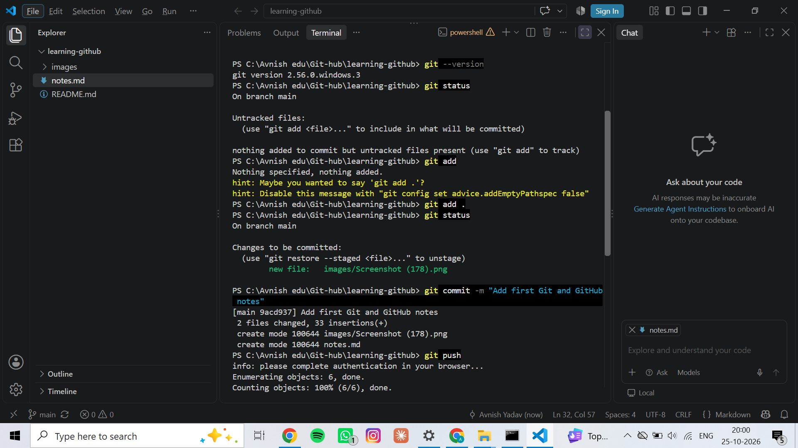
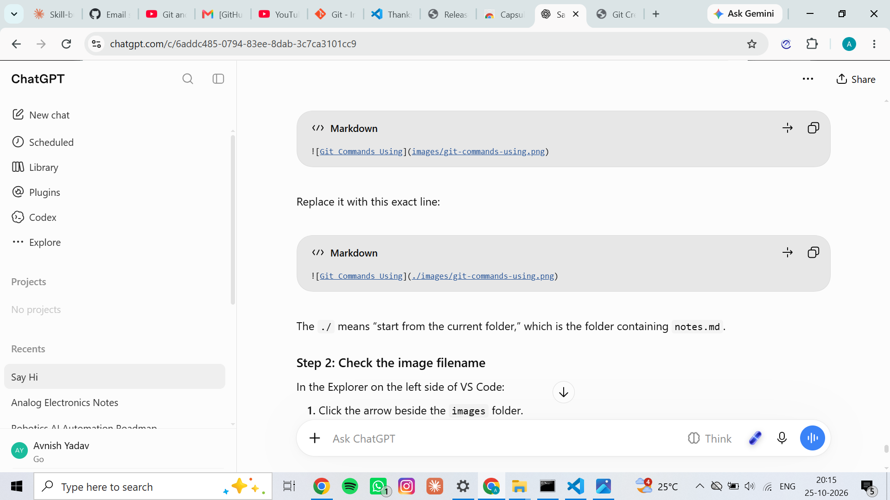
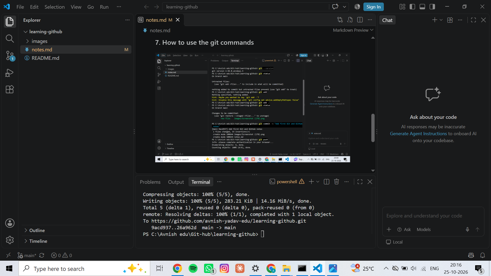
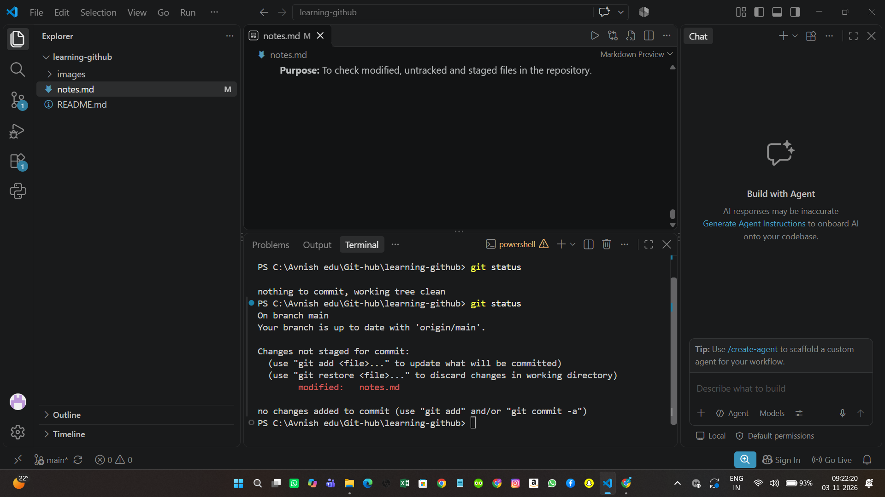
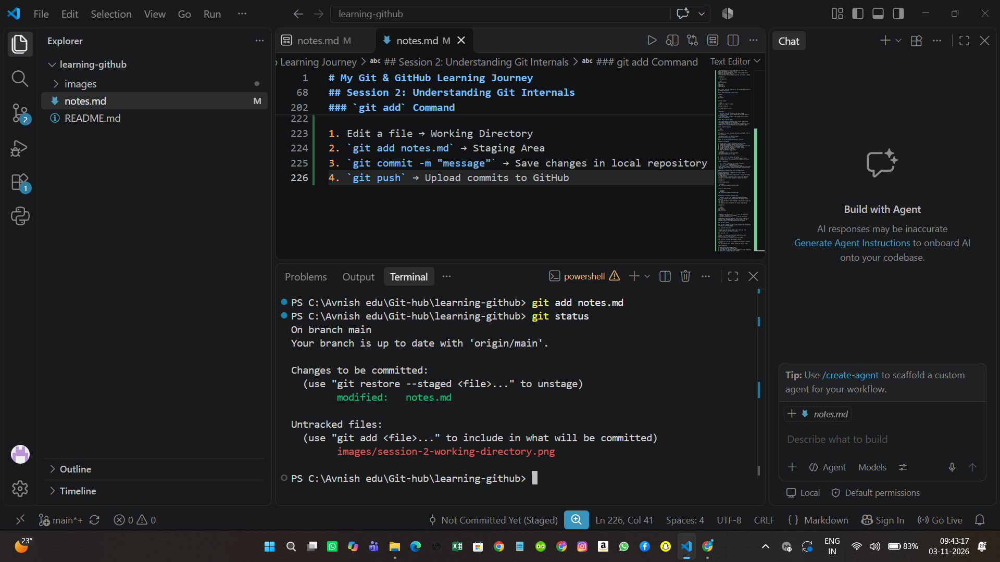
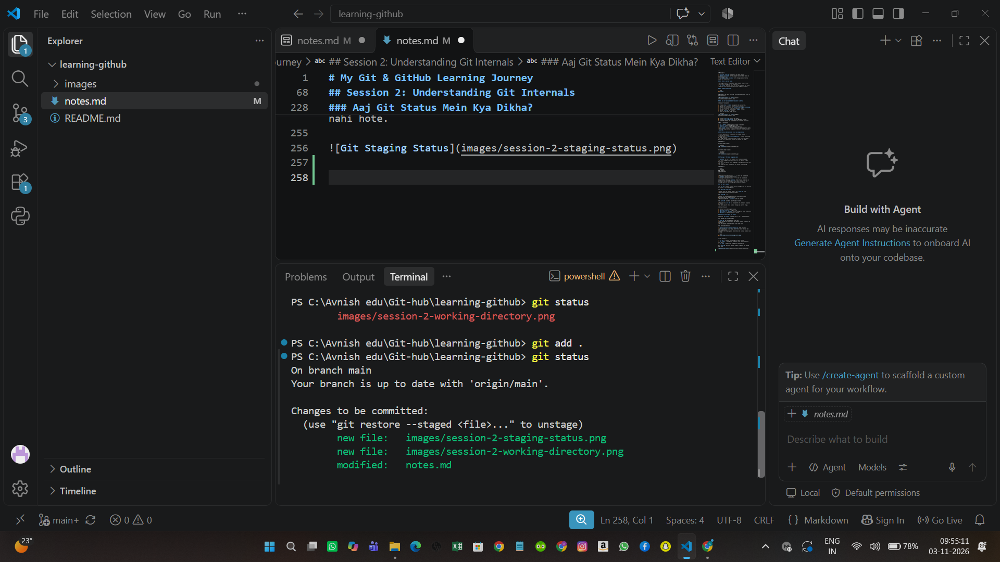

# My Git & GitHub Learning Journey

## Session 1: Introduction to Git and GitHub

### 1. What is Git?
Git is a version control system that tracks changes in files over time. It helps developers manage code and collaborate with others.

### 2. What is GitHub?
GitHub is an online platform where developers store Git repositories, share projects, and collaborate.

### 3. Git vs GitHub
- Git is a version control tool that runs on my computer.
- GitHub is an online platform for hosting Git repositories.

### 4. Important Git Terms
- **Repository:** A folder containing project files and Git history.
- **Commit:** A saved snapshot of changes.
- **Push:** Upload local commits to GitHub.
- **Pull:** Download and integrate changes from GitHub.
- **Clone:** Copy a remote repository to my computer.
- **Stage:** Select changes to include in the next commit.

### 5. My Learning Setup
- Editor: Visual Studio Code
- Notes file: notes.md
- Screenshot folder: images
- Goal: Learn Git and GitHub through regular practice.

### 6. What I Learned Today
- I created my learning-github folder.
- I created notes.md and the images folder.
- I learned the basic difference between Git and GitHub.

### 7. How to use the git commands

- git --version : used to get the version being used.
- git status : is se pta chlta hai ky changes huye hai abhi.
- git add . : . lagana zruri hai is se pta chlta hai ki current directroy k changes ko commit krne k k liye prepare krdo. NOTE : add aur . k beech mei space hona zruri hai.
- git commit -m "Your message to add while commit" : git commit se commit hota hai mtlb changed update krne k liye, -m "Message" is se message likhte hai commit ka, agr sirf git commit likh denge to commit to ho jaaega par fr notepad/text editor khul jaaega wha likhan padega message fr.
- git push : is se ab saare changes onlne push kr diye jaate hai ab changes ho chuke hai mtlb.

### Image not shwoing error fixing



### Meaning of `!` in Markdown

- `!` ka use Markdown mein **image display (embed)** karne ke liye hota hai.
- Isse Markdown ko pata chalta hai ki humein sirf link nahi dikhana, balki image ko directly display karna hai.

**Example:**

```markdown

```

**Iska breakdown:**
- `!` → Image display karne ke liye.
- `[Git Commands]` → Alt text; image load na ho toh ye text dikh sakta hai, aur accessibility mein bhi help karta hai.
- `(images/git-commands-using.png)` → Image ka file path.

**Difference:**
- `[Git Commands](images/git-commands-using.png)` → Clickable link.
- `` → Image directly display hoti hai.

**Important:** `!` aur `[` ke beech space nahi hona chahiye, warna Markdown image syntax sahi tarah render nahi hogi.

## Session 2: Understanding Git Internals

### 1. What is Working Directory?

- Working Directory is the folder where we create, edit, modify and delete our project files.
- Whenever we make changes to a file, those changes first happen in the Working Directory.
- Git can detect these changes using the `git status` command.

**Example:**

In my repository:

```text
learning-github/
│
├── images/
├── notes.md
└── README.md
```

When I edit `notes.md` and save it, the changes are present in my Working Directory.

### 2. Understanding git status output

Command:

```bash
git status
```

Possible output:

```text
Changes not staged for commit:

modified: notes.md

no changes added to commit
```

**Meaning:**

- `modified: notes.md` → The file has been changed.
- `Changes not staged` → The changes have not been added to the Staging Area.
- `no changes added to commit` → No changes are currently staged for committing.

### 3. What I Learned Today

- Working Directory is where we make changes to our files.
- Git tracks changes in our repository.
- `git status` helps us check the current state of our files.
- Modified files are not automatically staged for commit.

### 4. Command Practised

```bash
git status
```

**Purpose:** To check modified, untracked and staged files in the repository.



### 5. How to Take and Add Screenshots to GitHub

**Steps I followed:**

1. Pressed `Win + PrtScn` to capture the full screen.
2. Opened the Screenshots folder inside Pictures.
3. Renamed the screenshot to `session-2-working-directory.png`.
4. Cut the screenshot from the Screenshots folder.
5. Pasted it into the repository's `images` folder.
6. Opened `notes.md` in VS Code.
7. Added the Markdown image syntax:

```markdown

```

8. Pressed `Ctrl + S` to save the notes.
9. Pressed `Ctrl + Shift + V` to open Markdown Preview.
10. Checked whether the screenshot was displayed correctly.

**What I Learned:**

- `Win + PrtScn` → Takes a full-screen screenshot.
- `Ctrl + S` → Saves the Markdown file.
- `Ctrl + Shift + V` → Opens Markdown Preview.
- The `images` folder stores screenshots separately from notes.
- Markdown image syntax displays screenshots directly inside `notes.md`.

### Difference Between Code Block and Image Syntax

- Triple backticks (```) are used to display code as a formatted code block.
- Image syntax (``) is used to display an image directly.
- If image syntax is written inside a code block, Markdown displays it as plain text instead of showing the image.

**Example:**

Correct image display:

```markdown

```

Incorrect image display:

````markdown
```markdown

```
````
### Meaning of Markdown Language Label

- `markdown` is not a Git command or a Markdown command.
- It is a language label written after the opening triple backticks.
- It tells the editor which language is being shown inside the code block.
- VS Code uses this information for syntax highlighting.

**Example:**

````text
```markdown
# My Heading
**Hello World**
```
````

- Opening triple backticks (` ``` `) start the code block.
- `markdown` specifies the language.
- Closing triple backticks (` ``` `) end the code block.

**Important:** Writing `markdown` after triple backticks is optional. The code block will still work without it, but language-specific syntax highlighting may not appear.

### `git add` Command

The `git add` command is used to move changes from the Working Directory to the Staging Area.

**1. `git add notes.md`**

- Stages only the changes made in the `notes.md` file.
- Other modified files are not staged.

**2. `git add .`**

- Stages all changed and new files inside the current directory and its subdirectories.
- Files excluded by `.gitignore` are not staged.

**3. `git add` (without specifying a file)**

- Running only `git add` is incomplete and generally displays an error.
- We must specify which file or changes we want to stage.

**Git workflow:**

1. Edit a file → Working Directory
2. `git add notes.md` → Staging Area
3. `git commit -m "message"` → Save changes in local repository
4. `git push` → Upload commits to GitHub

### Aaj Git Status Mein Kya Dikha?

Jab maine `git status` command run ki, toh 2 cheezein dikhi:

**1. Changes to be committed**

- `notes.md` ke aage modified likha tha.
- Iska matlab meri notes file ke changes staging area mein aa chuke hain.
- Ab ye changes commit karne ke liye ready hain.

**2. Untracked files**

- `images/session-2-staging-status.png` dikh rahi thi.
- Iska matlab Git ko ye image abhi track karne ke liye add nahi ki gayi hai.
- Image ko bhi staging area mein bhejne ke liye ye command use karunga:

```bash
git add images/session-2-staging-status.png
```

**Yaad rakhna:**

- `git add` = Changes ko staging area mein bhejna.
- `git commit` = Changes ka snapshot local repository mein save karna.
- `git push` = Commits ko GitHub par upload karna.

Sirf `git add` karne se changes commit ya GitHub par upload nahi hote.



### Ab sb changes stage krte hai commands run kr ke fr dikhata hu uske baad screenshot

### `git add notes.md` vs `git add .`

Dono commands ka kaam files ko Staging Area mein bhejna hai, but inmein difference hai:

**1. `git add notes.md`**
- Sirf notes.md ke changes staging area mein jaate hain.
- Baaki files stage nahi hoti.

**2. `git add .`**
- Current folder aur uske andar ki saari eligible new aur modified files stage ho jaati hain.
- Isliye mere case mein notes.md aur dono screenshots ek saath stage ho gaye.

**Aaj ka conclusion:**

Pehle maine sirf `git add notes.md` run kiya tha, toh screenshots untracked reh gayi thi.

Uske baad `git add .` run kiya, toh teeno files staging area mein aa gayi.



### `git status` Command

Maine `git status` command run ki, jisse mujhe pata chala ki meri repository mein kya changes hue hain.

Pehli baar run kiya toh `notes.md` staged thi, lekin dono screenshots untracked the.

Phir maine `git add .` run kiya aur dobara `git status` check kiya. Ab `notes.md` aur dono screenshots staging area mein aa gaye the.

Isse mujhe samajh aaya ki `git status` se hum check kar sakte hain ki kaunsi files staged hain aur kaunsi abhi stage nahi hui hain.