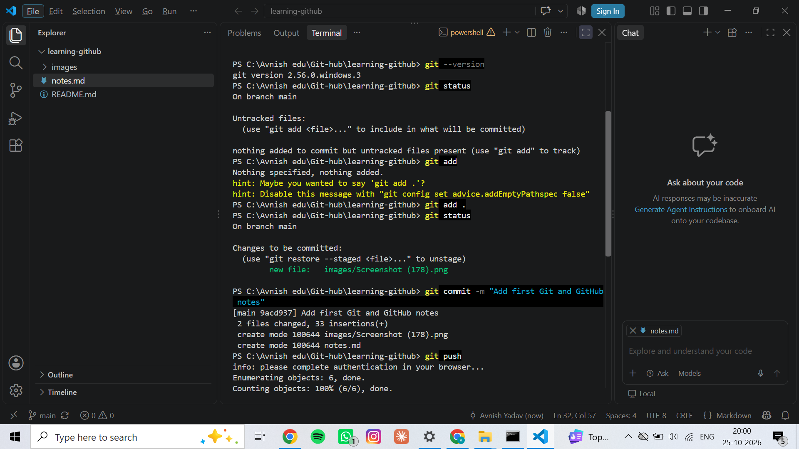
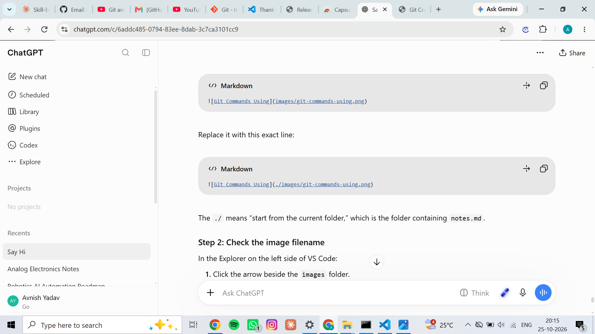
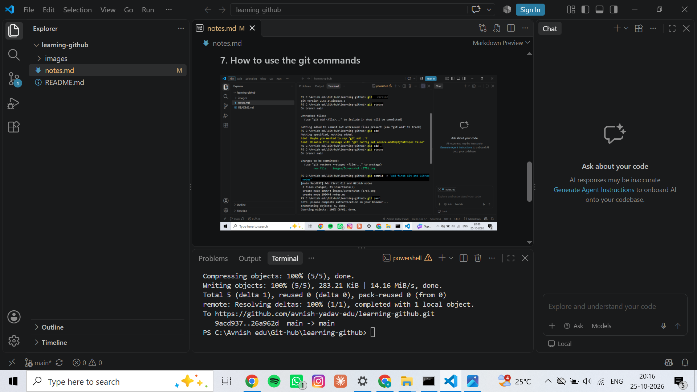

# My Git & GitHub Learning Journey

## Session 1: Introduction to Git and GitHub

### 1. What is Git?
Git is a version control system that tracks changes in files over time. It helps developers manage code and collaborate with others.

### 2. What is GitHub?
GitHub is an online platform where developers store Git repositories, share projects, and collaborate.

### 3. Git vs GitHub
- Git is a version control tool that runs on my computer.
- GitHub is an online platform for hosting Git repositories.

### 4. Important Git Terms
- **Repository:** A folder containing project files and Git history.
- **Commit:** A saved snapshot of changes.
- **Push:** Upload local commits to GitHub.
- **Pull:** Download and integrate changes from GitHub.
- **Clone:** Copy a remote repository to my computer.
- **Stage:** Select changes to include in the next commit.

### 5. My Learning Setup
- Editor: Visual Studio Code
- Notes file: notes.md
- Screenshot folder: images
- Goal: Learn Git and GitHub through regular practice.

### 6. What I Learned Today
- I created my learning-github folder.
- I created notes.md and the images folder.
- I learned the basic difference between Git and GitHub.

### 7. How to use the git commands

- git --version : used to get the version being used.
- git status : is se pta chlta hai ky changes huye hai abhi.
- git add . : . lagana zruri hai is se pta chlta hai ki current directroy k changes ko commit krne k k liye prepare krdo. NOTE : add aur . k beech mei space hona zruri hai.
- git commit -m "Your message to add while commit" : git commit se commit hota hai mtlb changed update krne k liye, -m "Message" is se message likhte hai commit ka, agr sirf git commit likh denge to commit to ho jaaega par fr notepad/text editor khul jaaega wha likhan padega message fr.
- git push : is se ab saare changes onlne push kr diye jaate hai ab changes ho chuke hai mtlb.

### Image not shwoing error fixing



### Meaning of `!` in Markdown

- `!` ka use Markdown mein **image display (embed)** karne ke liye hota hai.
- Isse Markdown ko pata chalta hai ki humein sirf link nahi dikhana, balki image ko directly display karna hai.

**Example:**

```markdown

```

**Iska breakdown:**
- `!` → Image display karne ke liye.
- `[Git Commands]` → Alt text; image load na ho toh ye text dikh sakta hai, aur accessibility mein bhi help karta hai.
- `(images/git-commands-using.png)` → Image ka file path.

**Difference:**
- `[Git Commands](images/git-commands-using.png)` → Clickable link.
- `` → Image directly display hoti hai.

**Important:** `!` aur `[` ke beech space nahi hona chahiye, warna Markdown image syntax sahi tarah render nahi hogi.
